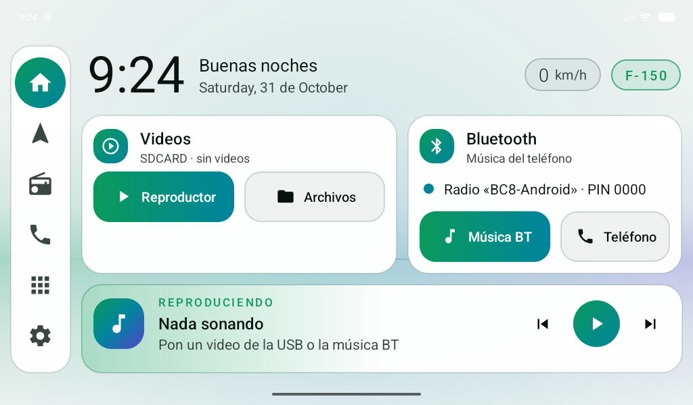
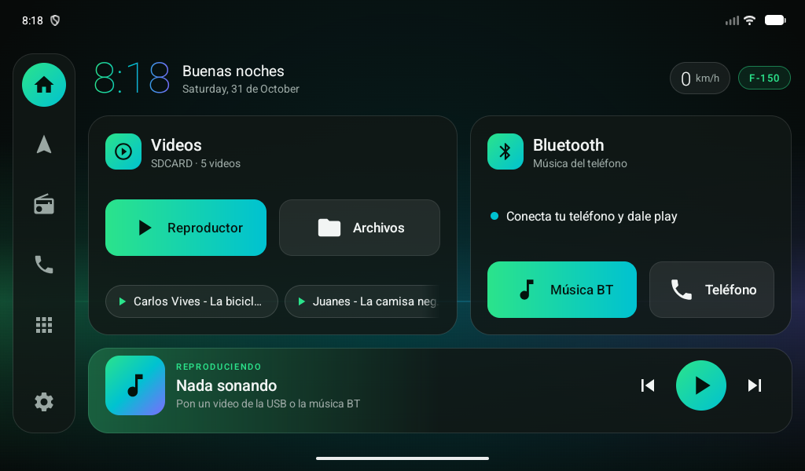

# Changelog

## 0.5.0 — 2026-10-31

Ajustes con los datos reales de la radio (Diagnóstico): es una Allwinner T3 con firmware
**NWD** (`k2001-nwd`) y **Android 7.1**, no Topway.

- **Protección de inicio** (servicio de accesibilidad): el sistema volvía a poner el launcher de
  fábrica (`com.android.launcher`); ahora RadioCar vuelve al frente solo. Aviso de configuración
  al abrir y nueva opción *Pantalla de inicio*.
- **Bluetooth**: Música BT y Teléfono abren la app BT real (`com.nwd.android.phone`). Ya no se abre
  el Bluetooth de Android, que es otro distinto y le pedía conexión al iPhone.
- **Reloj** más grande, letra normal (no delgada) y color sólido.
- **Tema claro / oscuro**: *Automático* (claro de 6:00 a 18:30), *Claro* o *Oscuro*. El claro se
  lee mucho mejor a contraluz.
- Apps NWD reconocidas: radio, video, gestor de archivos, teléfono.
- Diagnóstico: estado de inicio/protección/tema y pantallas internas de las apps de fábrica.

## 0.4.0 — 2026-10-31

Correcciones tras la primera prueba en la radio.

- **Interfaz grande**: la T3L viene a 160 dpi y todo se veía diminuto. RadioCar ahora ajusta su
  propia escala (≈1.5×). Opción *Tamaño de la pantalla*: Grande (por defecto), Mediano, Pequeño.
- **Inicio de verdad**: nuevo menú *Ajustes de RadioCar* (insignia F-150) con
  *Launcher de fábrica (Theme)*, que explica y abre la ficha para desactivarlo/reactivarlo.
  En la T3L "Theme" se impone aunque elijas otra app de inicio.
- **Bluetooth**: la radio usa un módulo BT propio ("BC8-Android") que Android no ve. La tarjeta ya
  no dice "apagado/sin teléfono" por error; indica *Conecta tu teléfono a «BC8-Android»*.
  Escucha los avisos TXZNet de la app BT de fábrica por si anuncia la canción.
- Apps de fábrica de la T3L reconocidas: `com.tw.bt`, `com.tw.video`, `com.tw.radio`,
  `com.tw.twfileexplore`.
- **Diagnóstico** (para soporte): versión, pantalla, inicio por defecto, accesos y apps de fábrica.
- Íconos de la barra lateral más grandes.

## 0.3.0 — 2026-10-31

Ajustado al uso real: los videos se ven **desde una memoria USB en el reproductor de fábrica**.

- Tarjeta **Videos** ahora es de la USB: detecta la memoria, cuenta los videos, botones a
  **Reproductor** y **Archivos**, y accesos a los últimos videos (un toque = reproducir).
  Se actualiza sola al meter/sacar la USB.
- Se quitó todo lo de YouTube (botones y atajos de búsqueda).
- Nuevo fondo por defecto **Horizonte camaleón**, diseñado para pantalla horizontal.
- **Selector de fondo** (tocar la insignia F-150): Horizonte, Aurora, Negro o **foto propia**.
  La foto se recorta a 1024×600, se oscurece para legibilidad y se guarda en la radio.
- Nuevos permisos: lectura de archivos/videos.

## 0.2.0 — 2026-10-31

Rediseño centrado en videos de música y música BT del teléfono.

- Tarjetas de Videos (YouTube) y Bluetooth, barra "Reproduciendo ahora" a todo lo ancho.
- Reloj, saludo y velocímetro en barra superior compacta.

## 0.1.0 — 2026-10-31

Primera versión: reloj grande con degradado camaleón, velocímetro GPS, tarjeta de música,
4 accesos rápidos configurables y cajón de apps.

