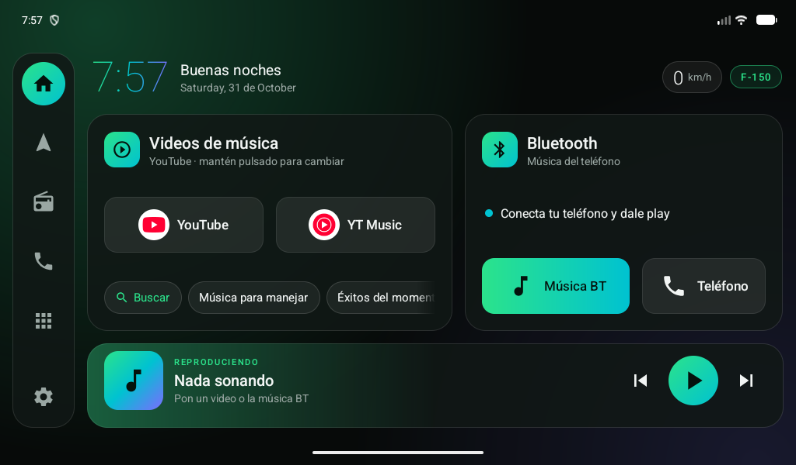
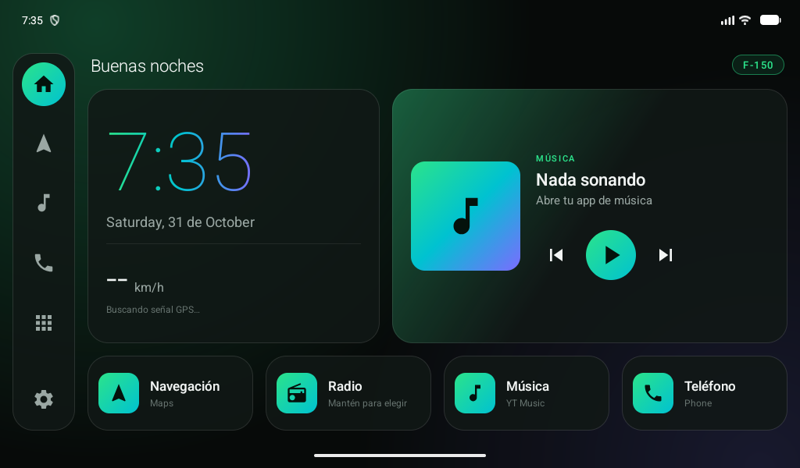

# Changelog

## 0.2.0 — 2026-10-31

Rediseño centrado en el uso real del carro: **videos de música** y **música BT del teléfono**.

- Nueva tarjeta **Videos de música**: botones a YouTube y YT Music con su ícono real,
  búsqueda directa y atajos de búsqueda guardables.
- Nueva tarjeta **Bluetooth**: estado del teléfono / lo que suena por BT, botones Música BT y Teléfono.
- Barra **Reproduciendo ahora** a todo lo ancho, con miniatura del video y brillo del color de la carátula.
- Reloj, saludo y velocímetro pasan a una barra superior compacta.
- Barra lateral: Inicio, Navegación, Radio, Teléfono, Apps, Ajustes.
- Detección de NewPipe / SmartTube / ReVanced como apps de video.
- Corrección: la barra de música ya no se estira a toda la altura.

## 0.1.0 — 2026-10-31

Primera versión.

- Reloj grande con degradado camaleón, velocímetro GPS.
- Tarjeta de música con controles.
- 4 accesos rápidos configurables (Navegación, Radio, Música, Teléfono).
- Cajón de apps. Tamaños para densidad 160 y 240.

