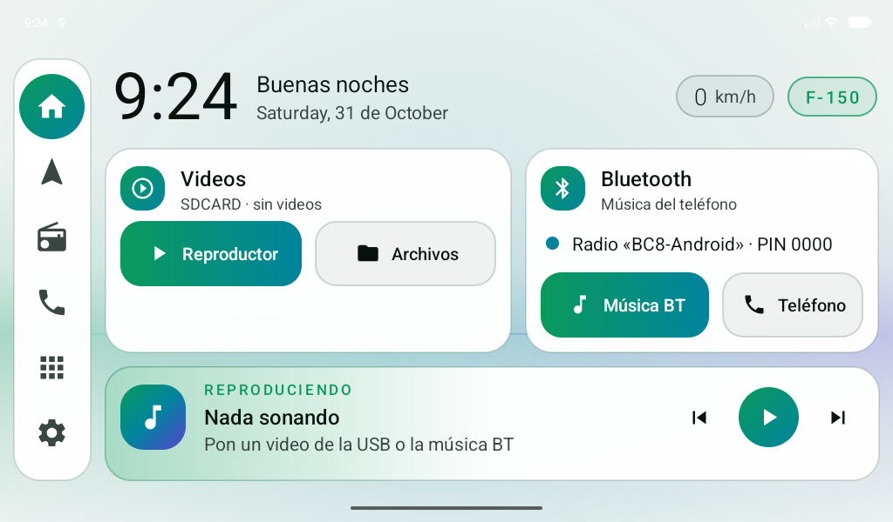
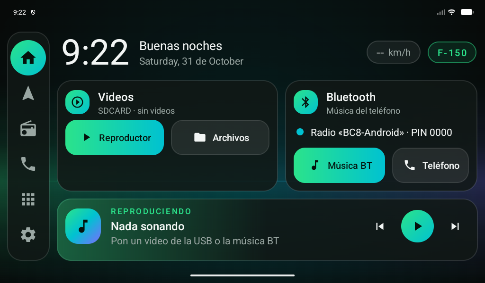

# RadioCar

Launcher (pantalla de inicio) moderno y liviano para radios Android chinas
**Allwinner T3 / T3L** (firmware NWD o Topway, pantalla horizontal 1024×600) — hecho para una **Ford F-150 2013**, pensado para lo que
más se usa en el carro: **videos desde la memoria USB** y **música del teléfono por Bluetooth**.

| Claro (día, a contraluz) | Oscuro (noche) |
|---|---|
|  |  |

- **No toca firmware, ni root, ni el MCU/CAN.** Es una app normal; el launcher de fábrica
  sigue instalado y se puede volver a él en cualquier momento.
- **APK de ~75 KB**, sin librerías externas: la radio solo tiene 1 GB de RAM.
- Tema oscuro con acento **"verde camaleón"** (verde → turquesa → violeta), como la pintura de la troca.

## Qué hace

| Zona | Función |
|---|---|
| **Videos** | Detecta la memoria USB y cuántos videos tiene. Botones al **Reproductor** de fábrica y a **Archivos**, y accesos a los últimos videos: un toque y se reproducen |
| **Bluetooth** | Estado del teléfono / lo que suena por BT, y botones a **Música BT** y **Teléfono** de la radio |
| **Reproduciendo ahora** | Carátula, título, artista, progreso y controles de lo que esté sonando |
| **Barra superior** | Hora, fecha, saludo, velocímetro GPS e insignia F-150 (tócala para los ajustes: fondo, tamaño, launcher de fábrica, diagnóstico) |
| **Barra lateral** | Inicio, Navegación, Radio FM, Teléfono, todas las apps, Ajustes |
| **Fondo** | Horizonte camaleón (por defecto), Aurora, Negro o **una foto tuya** |
| **Tema** | Automático (claro de día, oscuro de noche), Claro u Oscuro |
| **Inicio fijo** | Protección de inicio: si la radio vuelve a poner su launcher, RadioCar regresa al frente |

**Mantén pulsado** cualquier botón para elegir qué app abre. Detalles en [docs/04-uso.md](docs/04-uso.md).

## Instalar rápido

1. Descarga el APK desde [**Releases**](https://github.com/AdrianC1530/RadioCar/releases/latest)
   y cópialo a un pendrive.
2. En la radio: administrador de archivos → toca el APK → instalar.
3. Ábrelo y acepta los permisos (ubicación y archivos).
4. En el aviso **Pantalla de inicio** toca **Protección** y activa *RadioCar · protección de inicio*.
   Sin esto, la radio vuelve a poner su launcher de fábrica al encender o al pulsar ⌂.

Guía completa (permisos, ADB, cómo volver al de fábrica): [docs/03-instalacion.md](docs/03-instalacion.md).

## Documentación

| Documento | Contenido |
|---|---|
| [01 · Investigación](docs/01-investigacion.md) | Qué son estas radios, qué launchers existen y por qué hacer uno propio |
| [02 · Hardware T3L](docs/02-hardware-t3l.md) | Especificaciones de la radio y lo que falta confirmar |
| [03 · Instalación](docs/03-instalacion.md) | Pendrive, ADB, permisos y cómo volver atrás |
| [04 · Uso](docs/04-uso.md) | Videos USB, Bluetooth, fondo, consejos |
| [05 · Arquitectura](docs/05-arquitectura.md) | Cómo está hecho el código y por qué |
| [CHANGELOG](CHANGELOG.md) | Historial de versiones |

## Compilar

Requiere Android Studio (usa su JDK) y el SDK de Android 36.

```powershell
$env:JAVA_HOME = "C:\Program Files\Android\Android Studio\jbr"
.\gradlew.bat assembleRelease
# → app\build\outputs\apk\release\app-release.apk
```

Kotlin + vistas clásicas de Android · AGP 9.0.1 · Gradle 9.1 · minSdk 24 · sin AndroidX.
