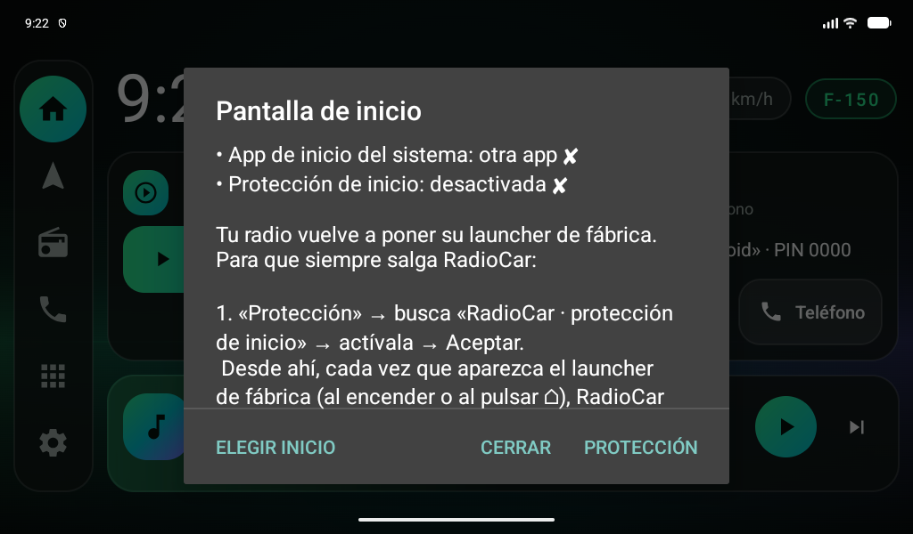

# 03 · Instalación

> Haz todo esto **con el carro estacionado**.

## 1 · Instalar el APK

### Opción A · Pendrive (la más fácil)

1. Descarga el APK desde [Releases](https://github.com/AdrianC1530/RadioCar/releases/latest)
   y cópialo a una memoria USB.
2. En la radio, abre el **Gestor de Archivos** y toca el APK.
   Si lo pide, permite instalar desde "orígenes desconocidos".
3. Abre **RadioCar** y acepta los permisos (ubicación y archivos).

Para actualizar, instala el APK nuevo encima: se conservan fondo, tema, tamaño y apps elegidas.

### Opción B · ADB

```powershell
$adb = "$env:LOCALAPPDATA\Android\Sdk\platform-tools\adb.exe"
& $adb install -r dist\RadioCar-0.5.0.apk
& $adb shell pm grant com.radiocar.launcher android.permission.ACCESS_FINE_LOCATION
& $adb shell pm grant com.radiocar.launcher android.permission.READ_EXTERNAL_STORAGE
& $adb shell cmd notification allow_listener com.radiocar.launcher/com.radiocar.launcher.MediaListenerService
```

## 2 · Que RadioCar quede fijo como pantalla de inicio

En estas radios **elegir RadioCar como "app de inicio" no basta**: el sistema vuelve a poner el
launcher de fábrica (al encender, o al pulsar el botón ⌂). La solución es la
**protección de inicio** de RadioCar:

1. Al abrir RadioCar aparece el aviso **Pantalla de inicio** (o: insignia **F-150** → *Pantalla de inicio*).
2. Toca **Protección** → se abre *Ajustes → Accesibilidad*.
3. Toca **RadioCar · protección de inicio** → actívala → **Aceptar**.
4. Listo: cada vez que aparezca el launcher de fábrica, RadioCar vuelve al frente solo.



Opcional: en el mismo aviso, **Elegir inicio** → RadioCar → Siempre.

> La protección solo detecta "cambió la pantalla"; no lee lo que hay en ella. Android muestra
> un aviso genérico al activarla.

### Usar el launcher de fábrica a propósito

Insignia **F-150** → **Abrir el launcher de fábrica**. La protección no lo tapa hasta que vuelvas
a abrir RadioCar.

### Quitar RadioCar del todo

1. *Ajustes → Accesibilidad → RadioCar · protección de inicio* → desactivar.
2. *Ajustes → Apps → RadioCar → Desinstalar*. La radio queda como antes.

### Alternativa avanzada (Topway "Theme")

En radios Topway cuyo launcher es "Theme" (`com.dofun.variety`) se puede **desactivar** desde
F-150 → *Desactivar launcher de fábrica (avanzado)*. En la radio NWD (`com.android.launcher`)
Android no permite desactivarlo desde la pantalla; usa la protección de inicio.

## Permisos

| Permiso | Para qué |
|---|---|
| Ubicación | Velocímetro GPS |
| Archivos / videos | Leer los videos de la memoria USB |
| Acceso a notificaciones | Ver y controlar lo que suena (toca la barra "Reproduciendo ahora") |
| Accesibilidad (opcional) | Protección de inicio |

## Si algo no funciona

Insignia **F-150** → **Diagnóstico**. **Sácale una foto** (desliza para ver todo) y compártela.
