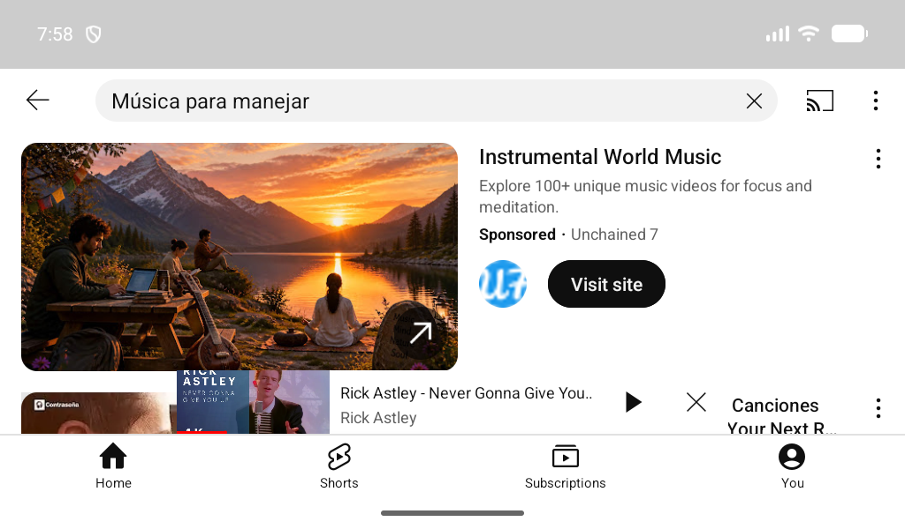
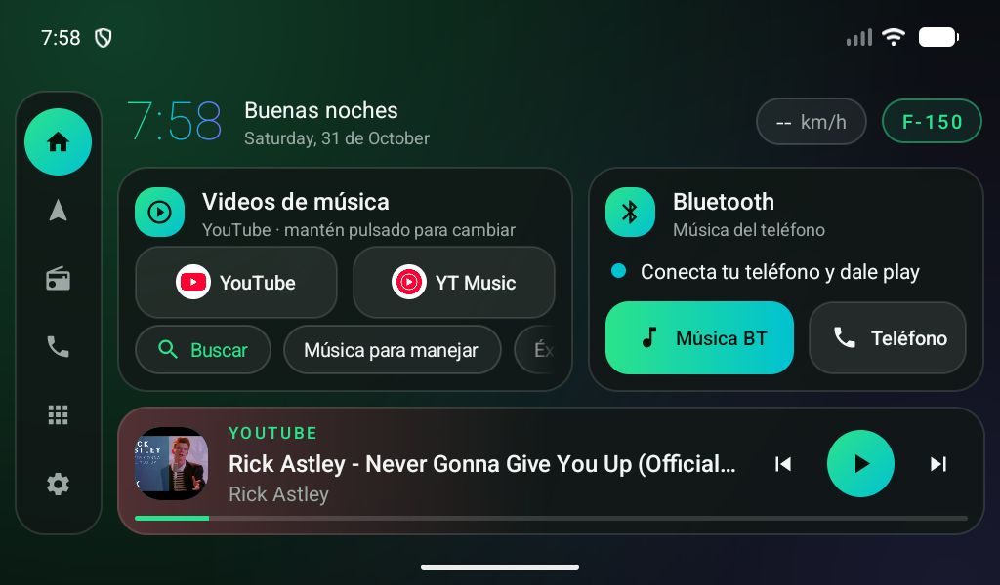

# 04 · Uso

## Videos de música

- **YouTube / YT Music**: abren la app. Muestran el ícono real de la app elegida.
- **Buscar**: escribe artista, canción o playlist y abre YouTube con los resultados.
  Con *Guardar atajo* queda como botón fijo.
- **Atajos** ("Música para manejar", etc.): un toque y busca eso en YouTube.
  - **+ Agregar** crea un atajo nuevo.
  - **Mantén pulsado** un atajo para quitarlo.
- **Mantén pulsado** el botón de YouTube o YT Music para usar otra app (NewPipe, Spotify…).

### Consejo: YouTube se pausa al salir

YouTube gratis **detiene el video** si vuelves a la pantalla de inicio (la reproducción en segundo
plano es de YouTube Premium). Alternativas:

- **[NewPipe](https://newpipe.net/)** (gratis, código abierto): reproduce en segundo plano,
  sin anuncios y es **más liviano** que YouTube — ideal para 1 GB de RAM. RadioCar lo detecta solo.
  Se instala desde su web o F-Droid (no está en Play Store).
- Dejar el video en pantalla completa mientras suena.

## Bluetooth (música del teléfono)

1. Conecta el teléfono a la radio por Bluetooth (botón **Teléfono** → app BT de la radio).
2. Toca **Música BT** y dale play.
3. La tarjeta muestra el estado:
   - 🟢 *Sonando: …* — la app BT está publicando la canción.
   - 🟢 *Conectado · nombre del teléfono*.
   - ⚪ *Sin teléfono conectado* / *Bluetooth apagado*.
   - 🔵 *Conecta tu teléfono y dale play* — la radio usa un chip BT propio que Android no ve;
     los botones igual abren la app BT de fábrica.

Los controles de la barra "Reproduciendo ahora" también funcionan con la música BT
(si la app de fábrica no publica la canción, se envían como teclas multimedia).

## Reproduciendo ahora

- Toca la barra para abrir la app que está sonando.
- Anterior / play-pausa / siguiente.
- El brillo de la barra toma el color de la carátula o miniatura.

## Barra lateral

Inicio · Navegación · Radio FM · Teléfono · Todas las apps · Ajustes.
**Mantén pulsado** cualquiera para elegir qué app abre.

## Cajón de apps

Ícono de cuadrícula. Toca una app para abrirla; mantenla pulsada para ver su info o desinstalarla.
