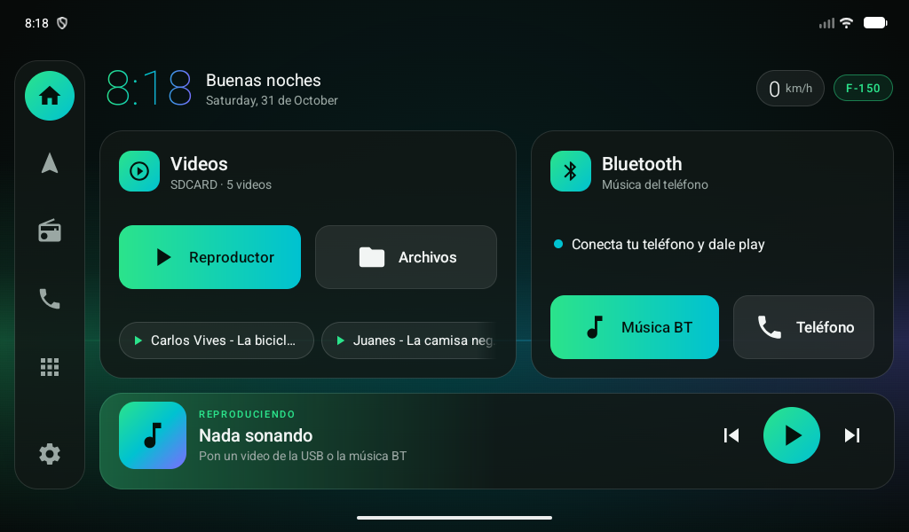
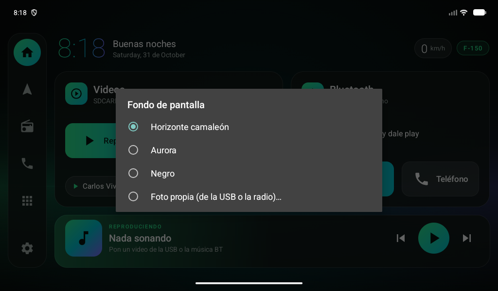
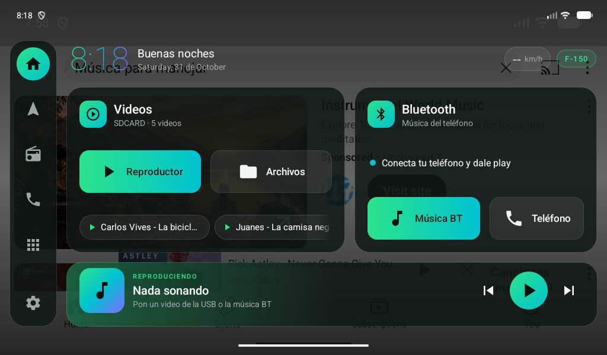

# 04 · Uso

## Videos (memoria USB)

1. Mete la memoria USB con los videos en la radio.
2. La tarjeta **Videos** muestra el nombre de la memoria y cuántos videos tiene
   (p. ej. *USB · 23 videos*). Si no hay USB: *Inserta tu memoria USB*.
3. Opciones:
   - **Reproductor** — abre el reproductor de video de la radio.
   - **Archivos** — abre el explorador para navegar las carpetas de la USB.
   - **Accesos a videos** (abajo, desliza a los lados) — los más recientes de la USB;
     un toque y se reproduce directamente en el reproductor de fábrica.
4. **Mantén pulsado** *Reproductor* o *Archivos* para usar otra app (VLC, MX Player…).

Notas:
- La primera vez pide permiso para **leer archivos**. Si lo negaste, toca *Permitir acceso a la USB*.
- Al meter la USB, la lista se actualiza sola (la radio tarda unos segundos en indexarla).
- Se buscan: mp4, mkv, avi, mov, 3gp, ts, flv, wmv, m4v, mpg, vob, rmvb.

## Bluetooth (música del teléfono)

1. Conecta el teléfono a la radio por Bluetooth (botón **Teléfono** → app BT de la radio).
2. Toca **Música BT** y dale play.
3. La tarjeta muestra el estado:
   - 🟢 *Sonando: …* — la app BT está publicando la canción.
   - 🟢 *Conectado · nombre del teléfono*.
   - ⚪ *Sin teléfono conectado* / *Bluetooth apagado*.
   - 🔵 *Conecta tu teléfono y dale play* — la radio usa un chip BT propio que Android no ve;
     los botones igual abren la app BT de fábrica.

Los controles de la barra "Reproduciendo ahora" también funcionan con la música BT
(si la app de fábrica no publica la canción, se envían como teclas multimedia).

## Reproduciendo ahora

- Toca la barra para abrir la app que está sonando.
- Anterior / play-pausa / siguiente.
- El brillo de la barra toma el color de la carátula.

## Fondo de pantalla

Toca la insignia **F-150** (arriba a la derecha) o **mantén pulsado** un espacio vacío del fondo.

| Fondo | Descripción |
|---|---|
| **Horizonte camaleón** | Por defecto. Luz verde → turquesa → violeta a lo ancho, como un atardecer reflejado en la pintura |
| **Aurora** | Resplandores verde y violeta en las esquinas |
| **Negro** | Negro puro, lo menos distractor de noche |
| **Foto propia** | Elige una foto (de la USB o de la radio). Se recorta a la pantalla horizontal, se oscurece para que se lean los textos y se guarda en la radio, así sigue aunque saques la USB |

Tip: una foto **horizontal** de la F-150 queda muy bien.

## Barra lateral

Inicio · Navegación · Radio FM · Teléfono · Todas las apps · Ajustes.
**Mantén pulsado** cualquiera para elegir qué app abre.

## Cajón de apps

Ícono de cuadrícula. Toca una app para abrirla; mantenla pulsada para ver su info o desinstalarla.
